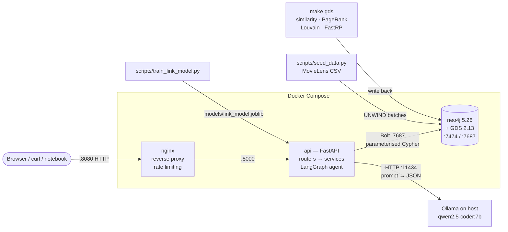
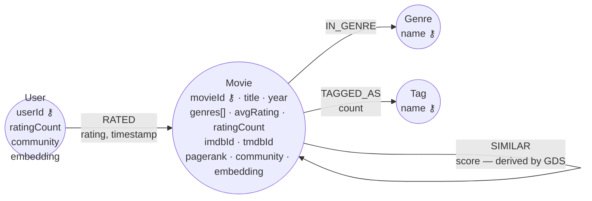
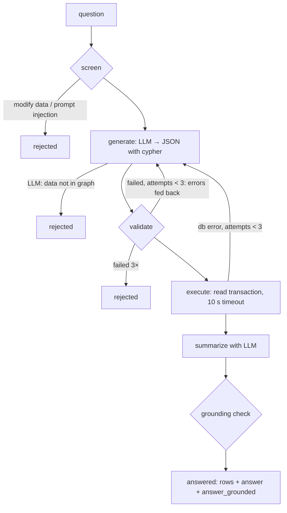
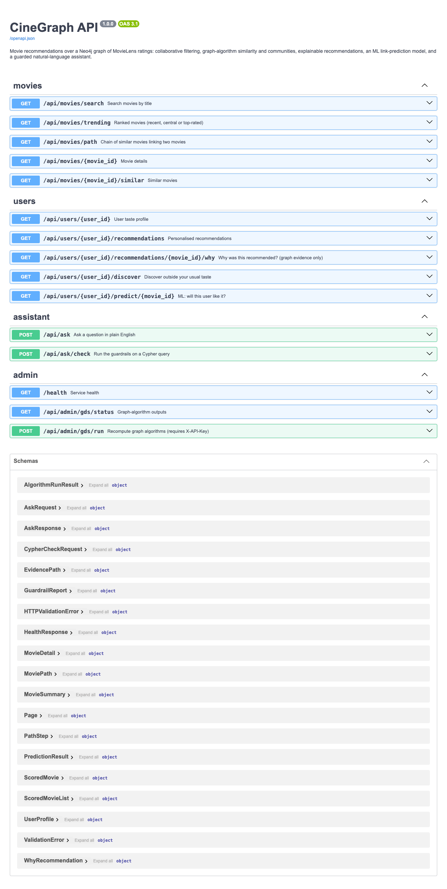
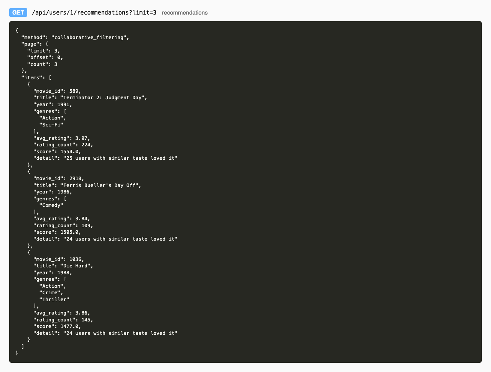
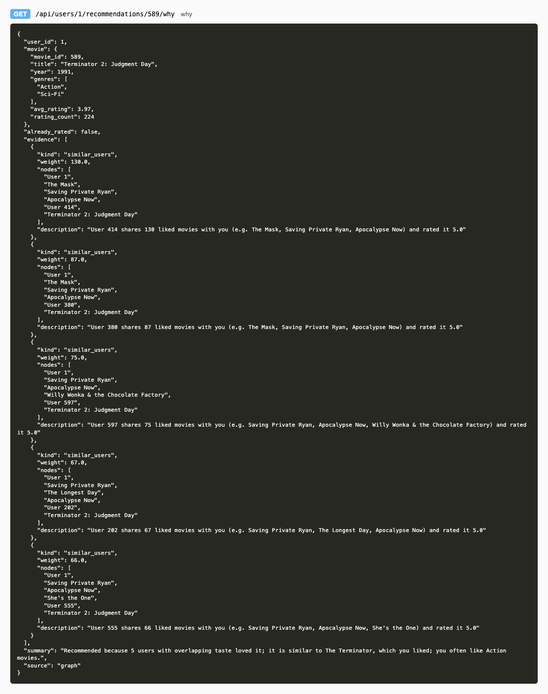
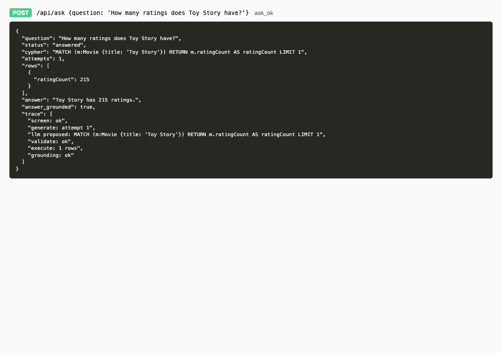
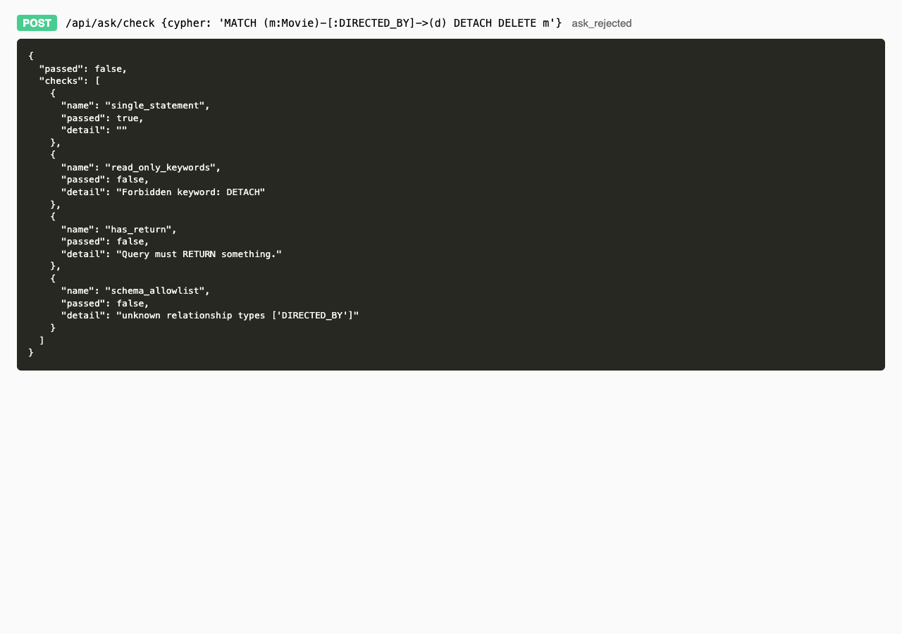
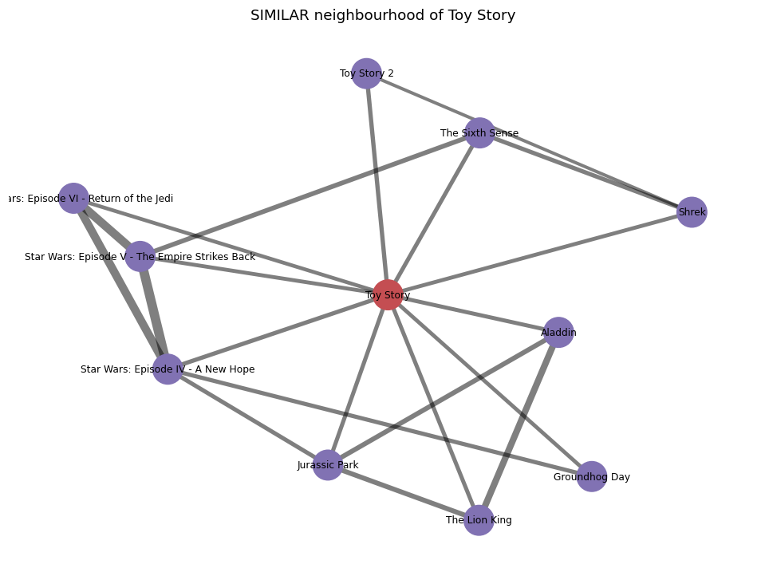

# CineGraph — a graph-native movie recommender

[](https://github.com/DehaTanaci/cinegraph/actions/workflows/lint.yml)
[](https://github.com/DehaTanaci/cinegraph/actions/workflows/tests.yml)


**AIDAMS 3A — GraphDB project #4 "Movie Recommender in Production" (Level 2). Individual project.**

CineGraph models MovieLens as a graph of people, the movies they rated, genres and tags. It serves
recommendations through a FastAPI service:

- **similar movies**, either because the same people loved them (graph algorithm) or because they share genres and tags;
- **personalised recommendations** from users whose taste overlaps yours, with a **"why was this recommended?"**
  endpoint built only from real graph paths;
- **discovery** outside your usual taste, using communities detected in the graph;
- **rankings** by recent popularity, rating, or centrality in the "taste network";
- **taste paths**: the chain of similar movies linking any two films;
- an **ML model** predicting whether a user will like a movie (graph embeddings + logistic regression);
- a **natural-language assistant** ("best sci-fi of the 90s?") that writes Cypher with a local LLM. Six layers
  of guardrails stop it from modifying data, inventing schema, or presenting made-up numbers as facts.

---

## Contents
1. [Quick start](#1-quick-start) · 2. [Makefile](#2-makefile) · 3. [Architecture](#3-architecture) ·
4. [Graph schema](#4-graph-schema) · 5. [Dataset](#5-dataset) · 6. [Modeling rationale](#6-modeling-rationale) ·
7. [API](#7-api) · 8. [Graph algorithms & ML](#8-graph-algorithms--ml) ·
9. [NL-to-Cypher assistant & guardrails](#9-nl-to-cypher-assistant--guardrails) ·
10. [Performance](#10-performance) · 11. [Security](#11-security) · 12. [Tests & quality](#12-tests--quality) ·
13. [Screenshots](#13-screenshots) · 14. [Git workflow](#14-git-workflow) · 15. [Limitations](#15-limitations) ·
[Appendix: anti-genericity](#appendix--our-schema-vs-an-ai-generated-schema)

---

## 1. Quick start

Requirements: Docker Desktop, Python 3.11+, [Ollama](https://ollama.com) (free, local LLM), ~8 GB free disk.

```bash
cp .env.example .env              # then set NEO4J_PASSWORD and ADMIN_API_KEY
make install                      # virtualenv + dependencies
make data                         # download MovieLens (small + 25M)
ollama pull qwen2.5-coder:7b      # local LLM (4.7 GB)
make docker-run                   # Neo4j + GDS, API, Nginx
make seed                         # load ml-latest-small (~15 s)
make gds                          # similarity, PageRank, Louvain, FastRP (~2 s)
make train                        # evaluate + train the link-prediction model (~10 s)
```

Then open **http://localhost:8080/docs** (Swagger, through Nginx) or **http://localhost:7474** (Neo4j Browser).

The LLM runs in the host's Ollama app, because Docker on macOS has no GPU access and would be ~10× slower. The API
container reaches it at `host.docker.internal`. To run it inside Docker instead:
`docker compose --profile ollama up -d` and set `OLLAMA_URL=http://ollama:11434`.

**Public image:** `docker.io/<dockerhub-user>/cinegraph-api:1.0` *(link added after `make docker-push`)*.

## 2. Makefile

| Command | What it does |
|---|---|
| `make help` | List all commands |
| `make install` | Create `.venv` and install `requirements-dev.txt` |
| `make data` | Download `ml-latest-small` and `ml-25m` into `data/raw/` |
| `make docker-run` / `make docker-down` | Start / stop the Compose stack |
| `make seed` / `make seed-large` | Load the small dataset / 2M ratings of ml-25m |
| `make gds` | Run graph algorithms and write results to the graph |
| `make train` | Evaluate (writes `docs/ml_report.md`) and train the serving model |
| `make eval` | Evaluate the NL assistant on 20 questions (writes `docs/agent_evaluation.md`) |
| `make benchmark` | Before/after index & rewrite benchmarks with `PROFILE` (writes `docs/benchmarks.md`) |
| `make run` | Run the API locally with auto-reload on :8001 |
| `make test` / `make test-unit` | All tests with coverage / tests that need no database |
| `make lint` / `make format` | pylint (fails under 9.5) / black |
| `make docker-push TAG=user/cinegraph-api:1.0` | Publish the API image |
| `make notebook` · `make clean` · `make tree` | Demo notebook · remove caches · project tree |

## 3. Architecture



| Service | Image | Port | Role |
|---|---|---|---|
| `neo4j` | official `neo4j:5.26-community` + GDS plugin | 7474, 7687 | Graph storage and algorithms |
| `api` | built from `Dockerfile` (python:3.12-slim, non-root) | internal 8000 | FastAPI app |
| `nginx` | official `nginx:1.27-alpine` | **8080** | Reverse proxy, per-IP rate limits (1 req/s on the LLM endpoint) |
| `ollama` *(optional profile)* | official `ollama/ollama` | 11435 | LLM inside Docker |

Code layout: `app/routers` (HTTP only) → `app/services` (Cypher) → `app/database` (driver wrapper, schema).
`app/agent` holds the LLM client, prompts, guardrails and the LangGraph workflow. `app/models` holds the Pydantic schemas.

## 4. Graph schema



| Element | Count (ml-latest-small) | Source |
|---|---:|---|
| `:Movie` | 9,742 | movies.csv + links.csv |
| `:User` | 610 | ratings.csv |
| `:Genre` | 19 | movies.csv |
| `:Tag` | 1,475 | tags.csv (normalised) |
| `RATED` | 100,836 | ratings.csv |
| `IN_GENRE` | 22,050 | movies.csv |
| `TAGGED_AS` | 3,574 | tags.csv (aggregated) |
| `SIMILAR` | 19,559 | **computed** (Node Similarity) |

**Constraints:** uniqueness on `Movie.movieId`, `User.userId`, `Genre.name`, `Tag.name`. Each one is also the index
that turns a lookup by id into a seek instead of a scan.
**Indexes:** full-text `Movie.title` (search with typos), range `Movie.year`, `Movie.ratingCount`, `Movie.community`,
and the relationship index `RATED.timestamp` (recent-trending window). Each index serves a specific endpoint; see the
benchmarks in [§10](#10-performance).

## 5. Dataset

[MovieLens](https://grouplens.org/datasets/movielens/) by GroupLens (University of Minnesota):
`ml-latest-small` (100,836 ratings, 610 users, 9,742 movies, 3,683 tags) for development, tests and the demo.
`ml-25m` (25M ratings) is used for larger-scale experiments (`make seed-large`).

**Why this dataset:** it is real user behaviour (not synthetic), it is documented, and it is naturally a
bipartite graph. It also mixes explicit signals (ratings) and free-text signals (tags) with timestamps, which
enables temporal evaluation.

**Cleaning done by `scripts/seed_data.py`:**
- the year is parsed out of titles (`Toy Story (1995)` → `year: 1995`); 12 titles have no year and keep `null`;
- trailing articles are restored (`Matrix, The` → `The Matrix`), so search and the LLM find titles naturally;
- `(no genres listed)` becomes an empty list, not a fake `Genre` node;
- tags are lower-cased and whitespace-normalised (`Funny` = `funny `), then aggregated per movie with a `count`;
- `avgRating`/`ratingCount` are precomputed after load, so list endpoints don't aggregate 100k edges per request.

## 6. Modeling rationale

| Decision | Why | Alternative rejected |
|---|---|---|
| **Rating as a relationship** `(:User)-[:RATED {rating, timestamp}]->(:Movie)` | A rating *is* a connection between exactly two things. As an edge, "people who liked what I liked" is a 3-hop pattern with no joins. | `(:Rating)` node between user and movie: one extra hop on every traversal and 100k extra nodes. Nothing needs to point *at* a rating. |
| **Genres as both nodes and a list property** | Nodes are needed to traverse (`genre affinity`, the "why" explanation, GDS projections), and a `Genre` node is a natural hub. The list property `m.genres` lets a filter like *"recommendations in Sci-Fi"* run without an extra hop, and gives the LLM a simple, robust pattern (`'Sci-Fi' IN m.genres`). A test checks the two never disagree. | Nodes only: every genre filter costs a hop. Property only: no genre traversal, and genre affinity becomes string matching. |
| **"Liked" = rating ≥ 4.0, a query-time threshold** | The rating distribution peaks at 4.0 (26%). Treating ≥ 4 as positive is the usual MovieLens convention. Keeping it a threshold (config `LIKE_THRESHOLD`) lets us change the definition without reloading. | A separate `LIKED` relationship: duplicates data and has to be kept in sync with ratings. |
| **Tags aggregated** `(:Movie)-[:TAGGED_AS {count}]->(:Tag)` | Recommendation and explanation care about *what a movie is tagged as*, not who typed it. Normalised Tag nodes become shared hubs that connect movies. | A user→movie edge per tag application (3,683 edges with a free-text property): tags can't be traversed as hubs and duplicates aren't merged. |
| **`SIMILAR` is a derived relationship with a `score`** | Computed by GDS Node Similarity from co-likes and written back, so `/similar` is a single index seek + 1 hop (65 ms). Kept separate from source data and recomputable (`make gds`). | Computing Jaccard live on every request: touches every co-rater of the movie. |
| **Year as a property, not a node** | Only ever used for range filters (`1990 ≤ year ≤ 1999`), which a range index does well. | `(:Year)` nodes: no traversal benefit, and range queries become awkward. |
| **No `(:Rating)` / user demographic nodes** | The dataset has no user demographics. Modelling them would mean inventing data. | (See appendix: the AI-generated schema invented `name`, `email`, `age`, `gender`.) |
| **Precomputed `avgRating`, `ratingCount`, `pagerank`, `community`** | Read-heavy service: compute once at load/batch time, read per request. Benchmark: 288× fewer db hits for the top-rated list. | Aggregating at request time. |

**Directions:** `RATED` goes user→movie (the user acts). `IN_GENRE`/`TAGGED_AS` go movie→category. `SIMILAR` is written
by GDS from each movie towards its top-10 neighbours (not symmetric), and queries traverse it in both directions
when the meaning is symmetric (paths, "why").

## 7. API

Full interactive documentation: `/docs` (Swagger) and `/openapi.json`. All list endpoints are paginated
(`limit` ≤ 50, `offset`). Errors use meaningful codes: **404** unknown id, **409** an algorithm or model has not been
computed yet, **422** invalid input, **401** missing admin key, **502** LLM failure, **503** database down.

| Method & path | Graph technique |
|---|---|
| `GET /api/movies/search?q=` | Full-text index |
| `GET /api/movies/{id}` | Index seek + tag aggregation |
| `GET /api/movies/{id}/similar?method=collaborative\|content` | GDS **Node Similarity** / live weighted **Jaccard** over shared genres + tags |
| `GET /api/movies/trending?metric=recent\|pagerank\|rating` | Relationship-index window + aggregation / GDS **PageRank** / precomputed rating |
| `GET /api/movies/path?from=&to=&weighted=` | **`shortestPath()`** (fewest hops, depth ≤ 8) / GDS **Dijkstra** (cost = 1 − similarity) |
| `GET /api/users/{id}` | Taste profile with subqueries |
| `GET /api/users/{id}/recommendations?genre=` | Collaborative filtering: 3-hop pattern, top-30 peers, `NOT EXISTS` subquery |
| `GET /api/users/{id}/recommendations/{movie}/why` | Four evidence patterns (similar users, similar movies, genre affinity, shared tags) |
| `GET /api/users/{id}/discover` | GDS **Louvain** communities |
| `GET /api/users/{id}/predict/{movie}` | ML link prediction on **FastRP** embeddings |
| `POST /api/ask` | NL → Cypher (LangGraph + guardrails) |
| `POST /api/ask/check` | Run the guardrails on a given Cypher query, without executing it |
| `GET /api/admin/gds/status`, `POST /api/admin/gds/run` | **Requires `X-API-Key`** |
| `GET /health` | Neo4j + LLM reachability |

```bash
curl "localhost:8080/api/users/1/recommendations?limit=3&genre=Sci-Fi"
curl "localhost:8080/api/users/1/recommendations/589/why"
curl "localhost:8080/api/movies/path?from=1&to=858&weighted=true"
curl -X POST localhost:8080/api/ask -H 'content-type: application/json' \
     -d '{"question": "Best sci-fi movies of the 90s with at least 30 ratings?"}'
curl -X POST localhost:8080/api/admin/gds/run -H "X-API-Key: $ADMIN_API_KEY"
```

Example: the recommendation query (`app/services/movie_service.py`):

```cypher
MATCH (u:User {userId: $id})-[r1:RATED]->(:Movie)<-[r2:RATED]-(peer:User)
WHERE r1.rating >= $like AND r2.rating >= $like AND peer <> u
WITH u, peer, count(*) AS overlap
ORDER BY overlap DESC LIMIT $peers                       // keep only the 30 most similar users
MATCH (peer)-[r:RATED]->(rec:Movie)
WHERE r.rating >= $like
  AND NOT EXISTS { (u)-[:RATED]->(rec) }                 // never recommend what you've seen
  AND ($genre IS NULL OR $genre IN rec.genres)           // list property: no extra hop
WITH rec, sum(overlap) AS score, count(peer) AS supporters
RETURN rec, score, supporters ORDER BY score DESC SKIP $offset LIMIT $limit
```

**Cost as the graph grows:** the first `MATCH` starts from one indexed user and expands to everyone who liked
the same movies, so its cost is roughly (movies the user liked) × (average likers per movie). It does not depend
on the total number of users. The `LIMIT 30` on peers caps the second expansion. Without that cap the work
grows with every co-rater, which is 3.7× more db hits for a heavy user (see benchmarks).

## 8. Graph algorithms & ML

`make gds` (or `POST /api/admin/gds/run`) projects in-memory graphs and writes results back:

| Algorithm | Projection | Output | Used by | Why this algorithm |
|---|---|---|---|---|
| **Node Similarity** (Jaccard, topK 10, cutoff 0.1, min 5 likers) | Movie→User "liked" edges | `SIMILAR {score}` | `/similar`, `/why`, `/path`, LLM | Item-to-item similarity from behaviour is the classic recommender signal. Jaccard normalises for popularity better than raw co-occurrence. |
| **PageRank** (weighted by score) | `SIMILAR` network | `Movie.pagerank` | `/trending?metric=pagerank` | Finds "taste hubs": films many others are similar to. That is different from "most rated". |
| **Louvain** | undirected User–Movie likes | `community` on users & movies (13 communities, modularity 0.33) | `/discover` | Communities on the bipartite graph group users *and* the movies they like together: taste clusters without choosing *k* in advance (k-means would need it). |
| **FastRP** (64 dims) | undirected likes | `embedding` | ML model | Fast, deterministic with a seed, and encodes multi-hop neighbourhoods. |
| **Dijkstra** | `SIMILAR`, cost = 1 − score | stream | `/path?weighted=true` | Prefers chains of *strong* similarity over the fewest hops. |

**ML workflow — link prediction** (`scripts/train_link_model.py`, report in [`docs/ml_report.md`](docs/ml_report.md)):
predict whether a user will like a movie. For each user, their most recent 20% of likes are hidden from the graph.
FastRP embeddings are computed on the remaining graph, and a logistic regression is trained on pair features
(element-wise product of the two embeddings, their cosine, log popularity). Negatives are random never-rated movies.

| | ROC AUC | Average precision |
|---|---:|---:|
| FastRP + logistic regression | **0.829** | **0.835** |
| Popularity baseline | 0.820 | 0.810 |

The model beats popularity, but only modestly. Popularity is a strong baseline when negatives are random, because
random movies are mostly obscure. We first tried a single global time cut and got 0.80 vs 0.82: *below* baseline.
Most later likes there came from users who didn't exist before the cut. We kept that finding in the report rather
than hiding it.

## 9. NL-to-Cypher assistant & guardrails

`POST /api/ask` runs a **LangGraph** state machine (`app/agent/graph.py`):



The LLM only ever **proposes text**. Deterministic code and Neo4j decide what runs and what counts as a fact:

| # | Guardrail | Catches |
|---|---|---|
| 1 | **Question screening** (regex) | "delete / set / create … movies", "ignore your instructions" — refused before any LLM call |
| 2 | **Structured output** (Ollama JSON schema, temperature 0) | Free-form or chatty replies; an empty `cypher` means "this data isn't in the graph" |
| 3 | **Static checks**: single statement, forbidden keywords (`CREATE`, `MERGE`, `DELETE`, `SET`, `CALL dbms/apoc/gds`, `LOAD CSV`, …; string literals are stripped first so the title *Set It Up* is fine), must `RETURN` | Writes, admin procedures, injection via `;` |
| 4 | **Schema allow-list**: every label, relationship type and property must be in the schema given to the LLM | Hallucinated schema such as `m.boxOffice` or `[:DIRECTED_BY]` |
| 5 | **Row cap**: `LIMIT` added or lowered to 50 | Huge result sets |
| 6 | **`EXPLAIN` by Neo4j**: must parse and be classified read-only (`'r'`); Cartesian product over a full scan refused | Syntax errors, anything the regexes missed, accidental cross joins |
| 7 | **Read transaction + 10 s timeout** (and a 30 s server-wide limit) | Last line of defence: the server itself refuses writes |
| 8 | **Answer grounding**: every number in the AI's summary must appear in the returned rows | Invented counts, ratings, years. `answer_grounded: false` is returned to the client |

Each response separates **`rows`** (verified data from Neo4j) from **`answer`** (AI-written, may contain
mistakes) and includes the generated `cypher`, every guardrail result, and a `trace` of the steps taken.

**Evaluation** (`make eval`, full table in [`docs/agent_evaluation.md`](docs/agent_evaluation.md)): 20 questions, ground truth computed from the database.

| | Result |
|---|---:|
| Answerable questions answered correctly | 14/14 |
| Unsafe or unanswerable questions refused | 6/6 |
| Answers whose numbers all appear in the data | 14/14 |
| Median latency (M3 Pro, local 7B model) | 3.4 s |

The first run scored 19/20. Asked about *box office revenue*, the model silently answered "most-rated movies"
instead. Nothing was technically unsafe, but the answer was misleading. We added an explicit "missing data →
empty query" rule plus a few-shot example, and it now declines. The schema allow-list remains the backstop if the
model invents a `boxOffice` property instead. Limits: 20 questions is a small test set, and the regex screen can
be bypassed by rephrasing. That is acceptable only because layers 3–7 do not depend on the question.

## 10. Performance

`make benchmark` drops each index, measures with `PROFILE`, recreates it and measures again (full table in
[`docs/benchmarks.md`](docs/benchmarks.md)). "db hits" counts the work the engine does, so it is comparable across machines.

| Case | db hits before → after | Plan change |
|---|---:|---|
| Movies of a decade (`Movie.year` range index) | 21,697 → 4,425 (4.9×) | `NodeByLabelScan` → `NodeIndexSeekByRange` |
| Ratings in last 90 days (`RATED.timestamp` relationship index) | 273,829 → 7,982 (34×) | label scan + expand → `DirectedRelationshipIndexSeekByRange` |
| User by id (uniqueness constraint) | 12,015 → 10,796 | `NodeByLabelScan` → `NodeUniqueIndexSeek` (only 610 users, so the gain is small here and grows linearly with users) |
| Recommendations: all peers → top-30 peers | 2,236,063 → 599,547 (3.7×), 216 → 53 ms | query rewrite |
| Top-rated list: aggregate per request → precomputed | 262,101 → 911 (288×) | query rewrite + index |
| Two movies by title (Cartesian) → by id | 39,002 → 36 | index-anchored pattern |

Other practices: every query is parameterised (plan caching, no injection), every list has `LIMIT`/`SKIP`
pagination, variable-length paths are bounded (`*..8`), and pattern existence uses `EXISTS {}` / `COUNT {}`
subqueries instead of collecting lists.

## 11. Security

- **Reverse proxy** (Nginx): the only public entry point. Per-IP rate limits: 10 req/s overall, **1 req/s on `/api/ask`**
  (the LLM is expensive), 1 MB body limit, 180 s timeout for LLM calls.
- **Authentication** on the sensitive endpoint: `POST /api/admin/gds/run` recomputes algorithms over the whole graph,
  so it requires `X-API-Key` (compared in constant time). Without a configured key, admin endpoints are disabled.
- Secrets only in `.env` (git-ignored). `.env.example` contains placeholders. The API container runs as a non-root user.

## 12. Tests & quality

`make test`: **95 tests, 83% coverage**:
- `test_guardrails.py`: every safety check, including tricky cases (keywords inside titles, `;` inside strings);
- `test_agent_workflow.py`: the LangGraph flow with a scripted fake LLM: retry after a rejected write, invented
  property rejected after 3 attempts, hallucinated number flagged, unanswerable question declined;
- `test_api.py`: validation (422), error codes (404/409/503), auth (401), pagination, the "why" contract;
- `test_neo4j_cypher.py` *(integration)*: connectivity, constraints and indexes, index seeks in plans, consistency of
  denormalised data, recommendations never include rated movies, genre filter, disjoint pages, GDS outputs, both
  path algorithms, and a read transaction refusing a write;
- `test_containers.py`: all three containers healthy, Neo4j HTTP, API health and Swagger *through Nginx*.

Integration and container tests skip themselves when the database or stack is not running. CI (`.github/workflows`)
runs pylint and the full suite against a Neo4j + GDS service container seeded with the small dataset.
`make lint`: pylint **9.87/10** with the course `.pylintrc`.

## 13. Screenshots

| | |
|---|---|
| Swagger UI (`/docs` via Nginx)  | Recommendations  |
| "Why was this recommended?" (graph evidence only)  | NL question answered  |
| LLM-style query blocked by guardrails  | Toy Story's `SIMILAR` neighbourhood  |

More visualisations (rating distributions, genres, communities) are in [`demo.ipynb`](demo.ipynb).

## 14. Git workflow

`main` is the stable branch. Each feature was developed on a `feat/*` branch and merged through a Pull Request with
review comments. Commits follow the `feat: / fix: / test: / docs: / refactor: / chore:` convention. The GitHub
Actions lint and test workflows run on every push and PR.

**Contributions:** individual project. All commits and merged PRs are by Deha Tanaci.

## 15. Limitations

- **Cold start:** new users or movies with no likes have no embedding and no peers. They fall back to the
  `rating` and `recent` rankings.
- MovieLens is a historical snapshot (last rating 2018), so "recent" means relative to the newest rating in the data.
- The `SIMILAR` graph only covers the 1,956 movies with ≥ 5 likers. Rarer films are reachable through `method=content`.
- The 7B local model is far weaker than hosted models. The guardrails are designed around that.

---

## Appendix — our schema vs an AI-generated schema

We asked `qwen2.5-coder:7b` to *"design a Neo4j graph schema"* from the same project description and file headers.
Its full output, verbatim, is in [`docs/ai_generated_schema.md`](docs/ai_generated_schema.md). In summary:
`User {userId, name, email, age, gender}`, `Movie {movieId, title, genres, imdbId, tmdbId}`, `Tag {tagId, tag}`,
`Rating {ratingId, rating, timestamp}`, plus `RATED`, `TAGGED (User→Movie)`, `SIMILAR_TO`,
`PART_OF (Movie→Genre)` and `LINKED_TO (Movie→Movie)`.

| AI-generated schema | Problem | Our decision |
|---|---|---|
| `User.name`, `email`, `age`, `gender` | **Not in MovieLens.** Inventing fields would make the LLM and API promise data that doesn't exist. | `User` has only `userId` + derived stats. |
| Both a `Rating` node *and* a `RATED {rating, timestamp}` relationship | The same fact stored twice, with no rule for keeping them consistent. | Rating is a relationship only (see §6). |
| `PART_OF (Movie→Genre)` with a `genre` property on the *relationship*, and no `Genre` label defined | Genre is stored on the edge instead of on a node, and the target node type doesn't exist. The genre-as-node vs property trade-off required by the spec is not addressed. | `Genre` node **and** `Movie.genres` list, each with a stated purpose and a consistency test. |
| `LINKED_TO (Movie→Movie) {linkType}` | `links.csv` holds *external* ids (IMDb/TMDb), not links between movies. The relationship has no meaning. | `imdbId`/`tmdbId` are properties. |
| `TAGGED (User→Movie) {tagId}` + `Tag {tagId}` | MovieLens tags have no id. Free-text tags on edges can't be traversed, and "Funny" ≠ "funny". | Normalised `Tag` nodes, `TAGGED_AS {count}` aggregated per movie. |
| `title` kept as `"Toy Story (1995)"`, no `year` | Year is buried in a string: no range filter, and the LLM must guess the format. | Year parsed into an indexed integer, articles fixed. |
| Indexes on `User.name`, `Rating.ratingId`, `:SimilarTo(similarityScore)`, `:LinkedTo(linkType)` | Indexes on non-existent or never-filtered fields cost writes for nothing. | Each index justified by an endpoint and measured (§10). |
| Example queries like `MATCH (u)-[:RATED {rating: 5.0}]-(m)` and `size((m)-[:RATED])` | Exact match on 5.0 ignores 4–4.5 "likes". `size()` on a pattern is invalid in Neo4j 5, and `[:RATED {movieId: m2.movieId}]` is not valid Cypher. | Threshold `rating >= $like`, `COUNT {}` subqueries, all queries tested. |
| `SIMILAR_TO` with no definition of how similarity is computed | An edge with no provenance. | `SIMILAR` is written by GDS Node Similarity with a documented config, and is recomputable. |
| No derived properties, no communities, no embeddings | Popularity and centrality would be recomputed per request. | `avgRating`, `ratingCount`, `pagerank`, `community`, `embedding` precomputed. |

**What we kept from it:** `RATED` as user→movie with rating and timestamp, a movie-to-movie similarity edge, and
uniqueness on `movieId`/`userId`. Those are the parts any reasonable model shares. Every difference above comes
from looking at the actual data or from a query an endpoint needs.
